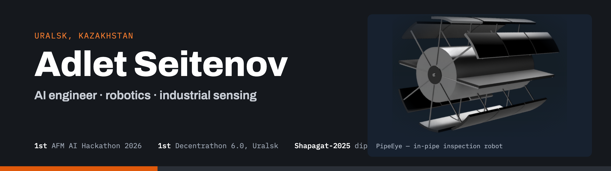

### Adlet Seitenov · Uralsk, Kazakhstan

I build AI tools that work in production or fully offline, and robots that measure the physical world. Grade 11 at NIS Uralsk.

| | |
|---|---|
| **1st place** | AFM AI Hackathon 2026, AI Media Watch track: ₸1,000,000 prize, 350+ participants overall |
| **1st place** | Decentrathon 6.0, Uralsk, Grand Mobile case: I led a team of 4 |
| **Diploma** | Shapagat-2025 invention contest (Qazpatent), Young Talent category, for PipeEye |
| **2nd place** | Robotics Battle 2026 (Batys Hub), PipeEye |
| **300+** | students trained in the school robotics club I founded |

### Projects

- **[КӨЗ · AI Media Watch](https://github.com/adletseitenov/AFMhackathon)**: finds signs of illegal gambling and pyramid schemes on social media and tells analysts what to check first. Own scikit-learn model with no external AI services; Whisper, OCR and CLIP for videos; a Telegram channel scanner; works offline. A human makes every decision. *1st place, AFM AI Hackathon 2026.*
- **locqa**: translation QA for a mobile game with 55M installs. Rule-based checks plus an LLM judge, and a native speaker approves every fix: 731 corrected strings. *1st place, Decentrathon 6.0 (Uralsk); private because the case data is under NDA.*
- **[Povodyr](https://github.com/adletseitenov/cursorhack)**: navigation for blind people. The phone hangs on the chest, a vision model reads the camera and guides by voice and vibration. [Live demo](https://povodyr.netlify.app).
- **WhatsApp AI concierge and bot template**: extended a live WhatsApp bot for a student-housing operator in Almaty (Google Sheets as the admin panel, photos in chat, personal data filtered before the model), then packaged it as a reusable template with manager handoff and tests.
- **KZ Lead Hunter**: a pipeline built to run daily: it finds Kazakhstani companies, reads their websites, scores each lead with an LLM and sends a Telegram digest.
- **PipeEye**: a robot designed to inspect pipes from the inside. Hall sensors catch magnetic flux leakage at defects, an ultrasonic probe measures wall thickness. I was the lead engineer (mechanics, electronics, sensors).
- **[NIS Pulse](https://github.com/adletseitenov/nis-pulse)**: grade forecasts and past-paper practice for NIS students.
- **[Halyk AI Challenge](https://github.com/adletseitenov/halykhacktahon)**: a PDF → OCR → parsing pipeline that extracts loan covenants; 36 of 36 cells right on the public set.
- **[PlastiBOT](https://github.com/adletseitenov/PlastiBOT)**: a beach-cleaning robot that sorts plastic with computer vision.
- **Local Coder**: a desktop app that runs a 9B coding model fully offline through Ollama.

### Stack

Python · TypeScript · Java · C++ · FastAPI · Next.js · PostgreSQL · scikit-learn · Whisper · OpenCV · MediaPipe · Ollama · Claude / OpenAI / DeepSeek APIs · Raspberry Pi · Arduino · ESP32

I build with AI coding agents (Claude Code, Codex) and own the architecture, the tests and the final call on every change.

### Contact

**[adletseitenov@gmail.com](mailto:adletseitenov@gmail.com)** · [Telegram @adletseitenov](https://t.me/adletseitenov)
